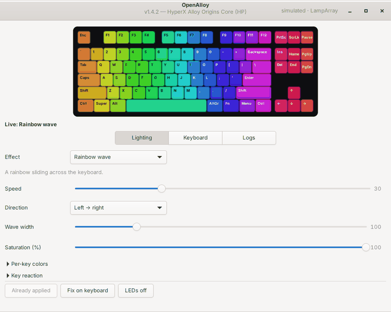
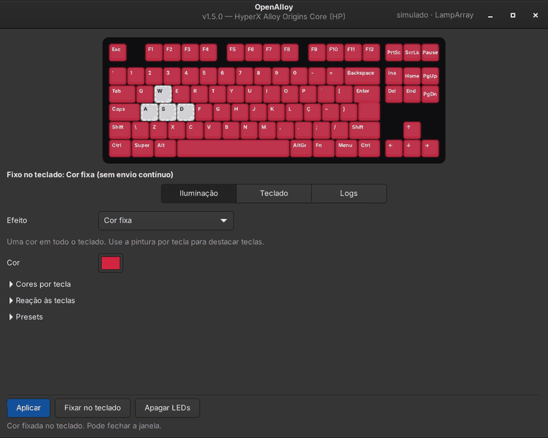

# OpenAlloy

[](https://github.com/evertonvcardoso/openalloy/actions/workflows/ci.yml)
[](https://github.com/evertonvcardoso/openalloy/releases/latest)
[](COPYING)

**Native Linux configurator for the HyperX Alloy Origins Core keyboard** — a working
alternative to HyperX NGENUITY, which exists only for Windows.

Per-key RGB, 20 effects (including key-reactive and sound-reactive ones), a fixed color
that stays with nothing running, presets, onboard-memory profiles where the firmware
allows them, a GTK 4 window, a full command line and a small `systemd --user` service.
No root daemon, no sudoers rule, no third-party Python dependencies in the core.

| | |
|---|---|
| Keyboards | HyperX Alloy Origins Core TKL `0951:16e6` and the HP version `03f0:098f` |
| Protocols | vendor channel (USB interface 2) **or** HID LampArray / Dynamic Lighting (interface 3), chosen automatically |
| Layouts | US (ANSI), Brazilian (ABNT2) and ISO, detected from the keyboard |
| Languages | English (default) and Brazilian Portuguese, through GNU gettext catalogs |
| Core | Python 3.10+, standard library only (no hidapi, no pyusb) |
| Interface | GTK 4.10+ through PyGObject and pycairo |
| Service | `systemd --user`; access granted by a udev `uaccess` rule to the lighting interfaces only |
| License | GNU GPL version 2 or later |





## Features

**Live lighting (software)**

- Per-key RGB on all 94 LEDs, with an animated preview identical to the keyboard.
- 20 effects: static, breathing, color cycle, rainbow wave, color wave, gradient, scanner,
  **fire**, **snake**, starlight, digital rain, candle, blink, off; **reactive** and
  **ripple** (react to key presses); and four that **react to the system sound**:
  equalizer, sound spectrum, sound pulse and music wave.
- **Key-press reaction on top of any effect** — light the key or send a ripple, in one
  color or rainbow (for example, a color wave plus ripples while typing).
- **Per-key colors on top of any effect** (for example, WASD and arrows highlighted over a
  rainbow wave): click or drag on the drawn keyboard, or use the brush.
- Presets: 19 built in plus your own, with JSON import and export.

**Fixed color without streaming (HID LampArray keyboards)**

- *Fix on keyboard* (or `openalloy hold`) sends the color once and stops; it stays on the
  keyboard with nothing running. The firmware loses it on unplug, reboot or suspend; with
  the service running it is restored by itself.

**Onboard memory (hardware), on firmware that supports it**

- Write any effect (rendered into up to 255 frames) to one of the **three profiles** in the
  keyboard's flash. It then runs with no software at all — at boot, in the BIOS, on another
  computer. Switch with **Fn + 1/2/3**.
- Read and write each profile's key-press color layer; select the active profile; set the
  hardware brightness.

**Integration**

- Detects Fn + 1/2/3: show the onboard profile or switch to a bound preset.
- Reconnects by itself when the keyboard is unplugged and plugged back.
- **System suspend**: a systemd-sleep hook resets the keyboard to its onboard profile
  before sleeping (a keyboard left in direct mode without frames may stop waking the
  computer), and the service notices the resume from its clocks and restores the
  lighting — also on systemd 256+, which freezes user services during sleep hooks.
- The window and the command line talk to the service through a Unix socket: changes
  apply at once, without restarting anything.

**Not possible** (the protocol is unknown for this keyboard): key macros and hardware key
remapping. Use [keyd](https://github.com/rvaiya/keyd) or
[input-remapper](https://github.com/sezanzeb/input-remapper). Game Mode keeps working on
the keyboard itself (Fn + F12).

## Installation

Download `openalloy-<version>.zip` from the [latest release](https://github.com/evertonvcardoso/openalloy/releases/latest), then:

```bash
unzip openalloy-*.zip && cd openalloy
./install.sh                  # add --lang pt_BR for Portuguese, --reactive for key-reactive effects
```

Then unplug and replug the keyboard once and run `openalloy doctor`.

The installer supports Debian/Ubuntu/SparkyLinux, Arch/CachyOS, Fedora and openSUSE. It
installs the system packages, installs OpenAlloy with `pipx`, adds the udev rule (lighting
interfaces 2 and 3 only — the interfaces that carry your keystrokes stay closed), enables
and restarts the user service, adds the menu entry, the sleep hook and the manual pages.
See [INSTALL](INSTALL) for every option, a careful step-by-step first install, upgrades,
rollback and uninstalling (`./uninstall.sh`, `--purge` also removes settings and presets).

## Usage

### Window

`openalloy gui`, or *OpenAlloy* in the application menu. It follows the system theme and
has three tabs:

- **Lighting** — effect and parameters, with collapsible sections for *Per-key colors*,
  *Key reaction* and *Presets*, and three buttons: **Apply** (live), **Fix on keyboard**
  (send once and stop) and **LEDs off**.
- **Keyboard** — brightness, *Test RGB*, give the lighting back to the keyboard, device
  information and settings (layout, language, FPS, LED color correction, service). Onboard
  memory appears only on firmware that supports it.
- **Logs** — the service's journal.

Without the service running, the window drives the keyboard itself while it is open.

### Command line

```bash
openalloy status
openalloy effects                                    # effects and their parameters
openalloy apply wave -s 40 -d left                   # rainbow wave to the left
openalloy apply static -c "#e31937" -k wasd=white -k arrows=#00b7ff
openalloy apply colorwave --colors "red,#ff8a00,#7a00ff" -p scale=140
openalloy apply colorwave -r ripple --react-color rainbow   # effect + key reaction
openalloy apply equalizer -p sensitivity=150         # reacts to the system sound
openalloy brightness 50%                             # 0-255, N%, + or -
openalloy hold red -k wasd=white                     # fixed color, nothing running
openalloy hold --release                             # give the LEDs back to the keyboard
openalloy preset list && openalloy preset apply matrix

openalloy onboard write 1                            # current effect to profile 1
openalloy onboard write 2 starlight --frames 120 --keypress "#00ffff"
openalloy profile 3                                  # select profile 3 (onboard mode)
openalloy release | resume                           # onboard <-> live

openalloy test-rgb                                   # test live RGB, unlock onboard writes
openalloy doctor                                     # diagnostics
openalloy language pt_BR                             # en, pt_BR
openalloy --simulate-hp --sim-layout ansi gui        # try it without the keyboard
```

Keys are given by name (`w`, `space`, `leftshift`, `enter`), LED index (`19`) or group
(`wasd`, `arrows`, `letters`, `numbers`, `frow`, `modifiers`, `nav`). The full reference is
in the manual pages: `man openalloy` and `man openalloyd`.

### Language and layout

The interface, command line, service and installer start in English. Switch with
*Keyboard › Settings › Language* (immediate), `openalloy language pt_BR`,
`openalloy --lang pt_BR <command>` (one command), `./install.sh --lang pt_BR` or
`OPENALLOY_LANG=pt_BR`. Numbers and dates follow the chosen language. The service log is
always in English.

US, ABNT2 and ISO keyboards share the same hardware and 94-LED map. OpenAlloy detects
yours from the vendor channel's variant byte or from the key each LED reports through
LampArray. Force it in *Settings › Layout* or with
`openalloy settings --set layout_override=ansi`.

## Two protocols, chosen automatically

| | Vendor channel (interface 2) | HID LampArray (interface 3) |
|---|---|---|
| Used when | the firmware accepts it (e.g. Kingston 21.08) | the firmware refuses the vendor channel (e.g. HP `03f0:098f` 21.16) |
| Live colors, effects, painting, sound, key reaction | yes | yes |
| Fixed color with nothing running | no (the firmware takes over after a few seconds) | yes |
| Brightness | hardware | software |
| Onboard profiles and writes | yes | no (not part of the standard) |
| Key-to-LED map | OpenRGB / hxoctkl table | reported by the keyboard |

`openalloy status` and the *Keyboard* tab show which one is in use. HID LampArray is the
public HID Usage Tables standard (page 0x59) behind Windows 11 Dynamic Lighting. Protocol
details: [docs/PROTOCOL.md](docs/PROTOCOL.md).

| | Live (software) | Onboard memory (hardware) |
|---|---|---|
| Needs the service | yes | no |
| Reactive and sound effects | yes | no (only the key-press layer) |
| Works at boot and on another computer | no | yes |
| Changes | instant | rewrite the profile |

## Safety of onboard writes

**Writing to the keyboard's memory starts locked on every keyboard.** It is unlocked once
you confirm that live RGB works on that unit: *Keyboard › Test RGB* or
`openalloy test-rgb` shows a green F-row, a red left half and a blue right half. If that
is what you see, writing is unlocked for that keyboard (USB ID and serial number) **and**
that firmware version; a firmware change asks for the test again.

The write follows the same sequence as NGENUITY, captured and validated by hxoctkl on
firmware 21.08: the 780-byte profile storage is read and written back **unchanged** (if it
cannot be read, the write is refused), the animation is sent between start and end
markers, and the key-press layer is verified by reading it back. Command `0x30` without
parameters, which resets the firmware, is never sent. Only the two supported USB IDs are
accepted, and arbitrary HID commands cannot be sent. This still writes to the flash of a
device without official documentation: use it at your own risk. A profile can be restored
by writing it again from OpenAlloy or NGENUITY. `OPENALLOY_ENABLE_FLASH=I_ACCEPT_THE_RISK`
in the service environment unlocks writing without the test.

## Troubleshooting

- **"no permission to open /dev/hidrawN"** — the udev rule is missing or the keyboard was
  not replugged: `openalloy udev-rules | sudo tee /etc/udev/rules.d/60-openalloy.rules`,
  `sudo udevadm control --reload-rules && sudo udevadm trigger`, replug the keyboard.
  `uaccess` applies to the active local session, not to SSH logins.
- **Colors flicker or fall back to the profile** — another program (OpenRGB) is fighting
  over the keyboard.
- **Colors differ from the screen (pinkish red)** — keep *Keyboard › Settings › Correct colors
  for LEDs* on (`led_gamma`, default 2.2).
- **Upgraded and nothing changed** — run `./install.sh` again (it restarts the service) or
  `systemctl --user restart openalloy`; `openalloy status` shows the running version.
- **Wrong layout on screen** — *Settings › Layout*, or
  `openalloy settings --set layout_override=abnt2`.
- **Logs** — `journalctl --user -u openalloy -f`.

## Development

```bash
python3 -m pytest                  # unit and integration tests, on simulated keyboards
python3 -m pytest lab/tests        # the real drivers against emulated USB keyboards
python3 lab/run_lab.py --work ./lab-work --zip openalloy-X.zip --out results/X
                                   # full lab: Debian VM + emulated USB keyboards
tools/test_install.sh OLD.zip NEW.zip   # install, upgrade and roll back in a temporary HOME
python3 tools/i18n.py all          # extract, update, compile and check the translations
python3 tools/hid_diagnostics.py   # read-only HID diagnostics, no install needed
ruff check openalloy tests
python3 -m openalloy.presentation.cli.main --simulate gui
```

- [docs/DEVELOPMENT.md](docs/DEVELOPMENT.md) — architecture, design decisions, translations.
- [docs/TESTING.md](docs/TESTING.md) — test suite, test lab, results and audit history.
- [docs/PROTOCOL.md](docs/PROTOCOL.md) — vendor channel and HID LampArray.
- [lab/README.md](lab/README.md) — how to build and run the test lab.
- [NEWS](NEWS) — release history; [ChangeLog](ChangeLog) — detailed changes.

## Reporting problems

Open an [issue](https://github.com/evertonvcardoso/openalloy/issues/new/choose) with the output of `openalloy doctor`,
`openalloy status` and `journalctl --user -u openalloy -b`. Security problems are reported
privately; see [SECURITY.md](SECURITY.md).

## License and credits

Copyright © 2026 Everton Vilhena Cardoso.

OpenAlloy is free software: you can redistribute it and/or modify it under the terms of
the GNU General Public License as published by the Free Software Foundation, either
version 2 of the License, or (at your option) any later version. It is distributed WITHOUT
ANY WARRANTY; see [COPYING](COPYING).

OpenAlloy builds on Linuity, PlasmaNGenuity and hyperx-studio (MIT) and on protocol
knowledge from OpenRGB and hxoctkl (GPL); see [THANKS](THANKS) for credits and license
notices, and [AUTHORS](AUTHORS).

HyperX, Alloy Origins and NGENUITY are trademarks of their respective owners. This project
is not affiliated with, authorized by or endorsed by HyperX, HP Inc. or Kingston Technology.
